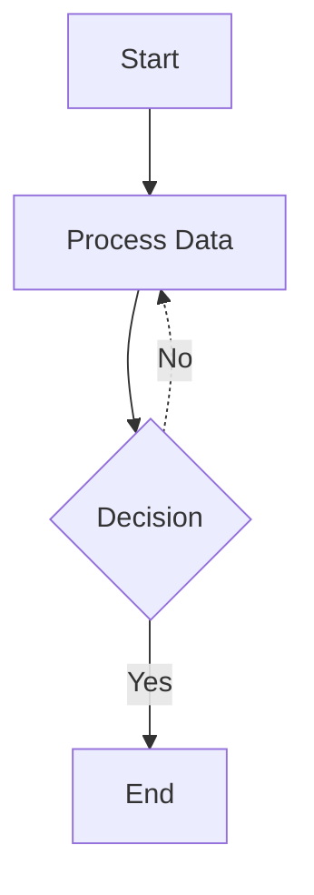
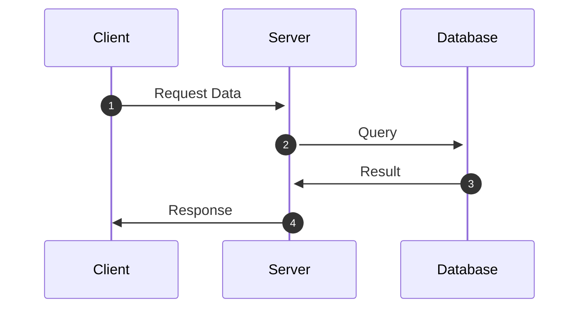
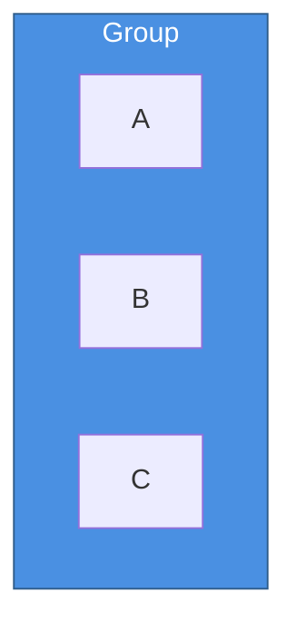

```mermaid
gantt
    dateFormat HH:mm
    Design : 09:00, 12:00
    Build : 12:00, 15:30
    Test : 15:30, 17:00
```

# Periscope

A C++ template library for generating Mermaid diagrams, supporting flowcharts, sequence diagrams, and gantt charts.

## Build and use

Periscope is a header-only CMake `INTERFACE` library. From this repo:

```bash
cmake -S . -B build
cmake --build build
./build/bin/PERISCOPE_SANDBOX   # optional demo (PERISCOPE_BUILD_SANDBOX=ON by default)
```

From another CMake project (`add_subdirectory`, `FetchContent`, or after `cmake --install` + `find_package(Periscope)`):

```cmake
find_package(Periscope REQUIRED)  # or: add_subdirectory / FetchContent
target_link_libraries(your_target PRIVATE Periscope::periscope)
```

Then `#include "periscope.h"`. Linking `Periscope::periscope` propagates the `include/` path and requires C++20.


## Example 1: Flowchart (using int as handle)

Create a flowchart with `int` handles. Properties are applied in one deduced pack
(`"..."_op_name`, nested enums like `NP_shape::*` / `LP_style::*`, or
`"Name"_np_class_def` for class styling). Replace-strategy owning props (`OP_name` /
`NP_shape` / `LP_activate` / …) appear **at most once** in a `new_object` / `>>` pack;
`LP_style` uses `bitwise_or` so style pieces may repeat and OR into one slot. Sequential
`.set()` after create is still fine for later mutation.
Edges are **one-shot**: write the full `a >> props >> b` expression (no bare
`std::string` / `const char*` on `>>` — literals use `"..."_op_name`, runtime names use
`label{}`).

```cpp
#include "periscope.h"
#include <iostream>

int main() {
    using namespace periscope;

    graph _graph;

    node& start = _graph.new_object<node>("Start"_op_name, NP_shape::k_rectangle);
    node& process = _graph.new_object<node>("Process Data"_op_name, NP_shape::k_rectangle);
    node& decision = _graph.new_object<node>("Decision"_op_name, NP_shape::k_diamond);
    node& end = _graph.new_object<node>("End"_op_name, NP_shape::k_rectangle);

    // One-shot >> chains; decorations (UDLs / nested enums) sit between nodes.
    start >> process >> decision >> "Yes"_op_name >> end;
    // LP_style pieces OR (same as k_dashed_arrow):
    decision >> "No"_op_name >> LP_style::k_dashed >> LP_style::k_arrow_mask >> process;

    _graph.set(GP_type<>::k_flowchart)
          .set(GP_output_format<>::k_markdown)
          .set(GP_flowchart_direction<>::k_top_to_down);
    std::cout << _graph.to_string() << std::endl;
    return 0;
}
```

**Output:**



## Example 2: Sequence Diagram (using pointer as handle, simulating runtime hooks)

Hook object interactions during program execution, using object pointers as handles.
Runtime strings use `.set<OP_name>(...)` after `new_object_at` (or `label{ msg }` on
`>>`); compile-time literals prefer `"..."_op_name`. `LP_activate::*` is a nested
enum decoration in the same one-shot chain.

```cpp
#include "periscope.h"
#include <iostream>
#include <map>

class Service {
public:
    std::string name;
    Service(const std::string& n) : name(n) {}

    static graph<const void*>& get_hook_graph() {
        static graph<const void*> hook_graph;
        return hook_graph;
    }

    void send_request(Service* target, const std::string& msg, bool activate_target = false) {
        auto& hook_graph = get_hook_graph();
        static std::map<const void*, bool> registered;

        handle<const void*> this_handle(reinterpret_cast<const void*>(this));
        handle<const void*> target_handle(reinterpret_cast<const void*>(target));

        // Same deduced pack as new_object; runtime name via sequential .set after create.
        if (!registered[this]) {
            hook_graph.new_object_at<node>(this_handle).set<OP_name>(name);
            registered[this] = true;
        }
        if (!registered[target]) {
            hook_graph.new_object_at<node>(target_handle).set<OP_name>(target->name);
            registered[target] = true;
        }

        auto& src = hook_graph.access<node>(this_handle);
        auto& dst = hook_graph.access<node>(target_handle);
        if (activate_target)
            src >> LP_activate::k_activate >> label{ msg } >> dst;
        else
            src >> label{ msg } >> dst;
    }

    static void print_graph() {
        auto& hook_graph = get_hook_graph();
        hook_graph.set(GP_type<>::k_sequence)
                  .set(GP_output_format<>::k_markdown)
                  .set(GP_sequence_show_number<>::k_on);
        std::cout << hook_graph.to_string() << std::endl;
    }
};

int main() {
    Service client("Client");
    Service server("Server");
    Service database("Database");

    client.send_request(&server, "Request Data", true);
    server.send_request(&database, "Query", true);
    database.send_request(&server, "Result");
    server.send_request(&client, "Response");

    Service::print_graph();
    return 0;
}
```

**Output:**



## Example 3: Gantt Chart (using int as handle)

Create a gantt chart with time-tick start/end on each task node. Ticks are
formatted to match `GP_date_format` (zero-padded `HH:mm` or `MM-DD`):

```cpp
#include "periscope.h"
#include <iostream>

int main() {
    using namespace periscope;

    graph _graph;
    _graph.set(GP_type<>::k_gantt)
          .set(GP_output_format<>::k_markdown)
          .set(GP_date_format<>::k_hour_minute);

    // Pack name + ticks via deduced UDLs (mirrors OP_/NP_ naming)
    _graph.new_object<node>("Design"_op_name, "9:0"_np_time_tick_start, "12:0"_np_time_tick_end);
    _graph.new_object<node>("Build"_op_name, "12:0"_np_time_tick_start, "15:30"_np_time_tick_end);
    _graph.new_object<node>("Test"_op_name, "15:30"_np_time_tick_start, "17:0"_np_time_tick_end);

    std::cout << _graph.to_string() << std::endl;
    return 0;
}
```

**Output:**



## Example 4: classDef, subgraph, and sequence notes

Style nodes with `"Name"_np_class_def` (literal). Vector-of-handle props take
`property_literal<Prop>{ node_a, node_b }` — no `.get_handle()` at the call site
(`NP_subgraph_node`, `MNP_basis`).

```cpp
#include "periscope.h"
#include <iostream>

int main() {
    using namespace periscope;

    graph flow;
    flow.set(GP_type<>::k_flowchart)
        .set(GP_output_format<>::k_markdown)
        .set(GP_flowchart_direction<>::k_top_to_down);

    flow.new_object<class_def>(
        "GroupStyle"_op_name, "#4A90E2"_mcd_fill, "#2E5C8A"_mcd_stroke, "#fff"_mcd_color);

    node& a = flow.new_object<node>("A"_op_name, NP_shape::k_rectangle);
    node& b = flow.new_object<node>("B"_op_name, NP_shape::k_rectangle);
    node& c = flow.new_object<node>("C"_op_name, NP_shape::k_rectangle);
    flow.new_object<node>(
        "Group"_op_name, property_literal<NP_subgraph_node>{ a, b, c }, "GroupStyle"_np_class_def);

    std::cout << flow.to_string() << std::endl;

    graph seq;
    seq.set(GP_type<>::k_sequence).set(GP_output_format<>::k_markdown);
    node& client = seq.new_object<node>("Client"_op_name);
    node& server = seq.new_object<node>("Server"_op_name);
    seq.new_object<note>("shared context"_op_name, property_literal<MNP_basis>{ client, server });
    seq.new_object<note>("on client"_op_name, property_literal<MNP_basis>{ client }, MNP_orient::k_right);

    std::cout << seq.to_string() << std::endl;
    return 0;
}
```

**Output:**



```mermaid
sequenceDiagram

participant 0 as Client
participant 1 as Server
Note over 0, 1 : shared context
Note right of 0 : on client
```
