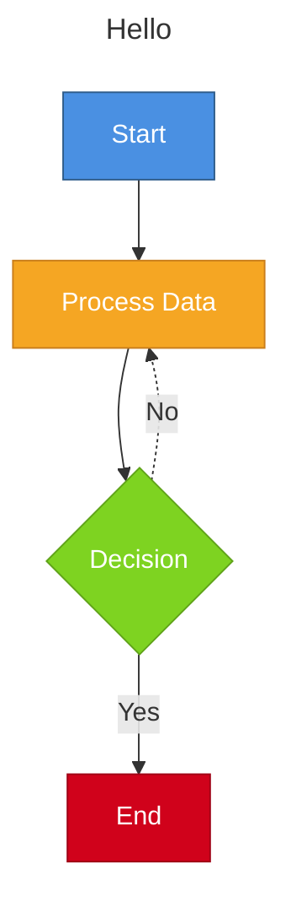
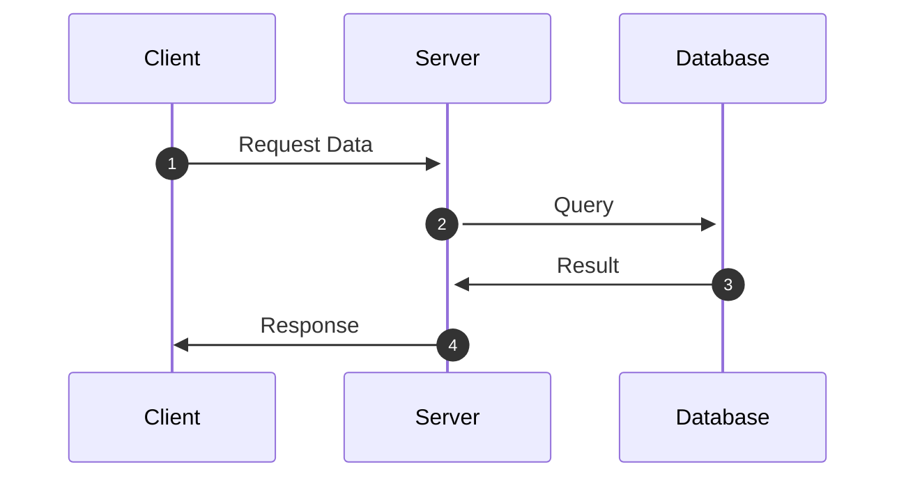

```mermaid
gantt
    dateFormat HH:mm
    Design : 09:00, 12:00
    Build : 12:00, 15:30
    Test : 15:30, 17:00
```

# Periscope

C++20 header-only library that builds Mermaid diagrams (flowchart, sequence, gantt) from typed graph objects.

## Example 1 — Flowchart

```cpp
#include "periscope.h"
#include <iostream>

using namespace periscope;

int main() {
    graph _graph;
    _graph >> "Hello"_name
           >> GP_type<>::k_flowchart
           >> GP_output_format<>::k_markdown
           >> GP_flowchart_direction<>::k_top_to_down;

    class_def(_graph) >> "Start"_name >> "#4A90E2"_fill >> "#2E5C8A"_stroke >> "#fff"_color;
    class_def(_graph) >> "Process"_name >> "#F5A623"_fill >> "#C97E1C"_stroke >> "#fff"_color;
    class_def(_graph) >> "Decision"_name >> "#7ED321"_fill >> "#5FA319"_stroke >> "#fff"_color;
    class_def(_graph) >> "End"_name >> "#D0021B"_fill >> "#A00115"_stroke >> "#fff"_color;

    node& start = node(_graph) >> "Start"_name >> NP_shape::k_rectangle >> "Start"_class;
    node& process = node(_graph) >> "Process Data"_name >> NP_shape::k_rectangle >> "Process"_class;
    node& decision = node(_graph) >> "Decision"_name >> NP_shape::k_diamond >> "Decision"_class;
    node& end = node(_graph) >> "End"_name >> NP_shape::k_rectangle >> "End"_class;

    start >> process >> decision >> "Yes"_name >> end;
    decision >> "No"_name >> LP_style::k_dashed >> LP_style::k_arrow_mask >> process;

    std::cout << _graph.to_string() << std::endl;
}
```



## Example 2 — Sequence

```cpp
#include "periscope.h"
#include <iostream>

using namespace periscope;

int main() {
    graph seq;
    seq >> GP_type<>::k_sequence
        >> GP_output_format<>::k_markdown
        >> GP_sequence_show_number<>::k_on;

    node& client = node(seq) >> "Client"_name;
    node& server = node(seq) >> "Server"_name;
    node& database = node(seq) >> "Database"_name;

    client >> LP_activate::k_activate >> "Request Data"_name >> server;
    server >> LP_activate::k_activate >> "Query"_name >> database;
    database >> "Result"_name >> server;
    server >> "Response"_name >> client;

    std::cout << seq.to_string() << std::endl;
}
```



## Example 3 — Gantt

```cpp
#include "periscope.h"
#include <iostream>

using namespace periscope;

int main() {
    graph _graph;
    _graph >> GP_type<>::k_gantt
           >> GP_output_format<>::k_markdown
           >> GP_date_format<>::k_hour_minute;

    node(_graph) >> "Design"_name >> "9:0"_tick_start >> "12:0"_tick_end;
    node(_graph) >> "Build"_name >> "12:0"_tick_start >> "15:30"_tick_end;
    node(_graph) >> "Test"_name >> "15:30"_tick_start >> "17:0"_tick_end;

    std::cout << _graph.to_string() << std::endl;
}
```



## Build

```bash
cmake -S . -B build && cmake --build build
./build/bin/PERISCOPE_SANDBOX
```

In another project (`add_subdirectory` / `FetchContent` / `find_package(Periscope)`):

```cmake
target_link_libraries(your_target PRIVATE Periscope::periscope)
```

`#include "periscope.h"` — linking `Periscope::periscope` pulls in `include/` and C++20.

## API at a glance

| Spell | Meaning |
| --- | --- |
| `Object(graph) >> props…` | create `node` / `note` / `class_def` (assign or discard; bare `Object(g)` aborts) |
| `a >> b >> c` | default edges between consecutive nodes |
| `a >> "Yes"_name >> LP_style::k_dashed >> b` | decorations sit between nodes |
| `graph >> GP_…` | configure (`>>` ≡ `set` on `graph&`) |
| `"…"_name` / `_class` / `_fill` / `_stroke` / `_color` / `_tick_start` / `_tick_end` | short string UDLs → property literals |
| `new_object_at` / `.set<Prop>(…)` / `new_object<link>` | escape hatches; **`link` stays `new_object<link>`** |
| `label{ runtime_string }` | runtime edge/node name (no bare `std::string` on `>>`) |
| `property_literal<NP_subgraph_node>{ a, b }` | vector-of-handle props |

Mermaid under each example is the verbatim `to_string()` body from running that snippet alone.
