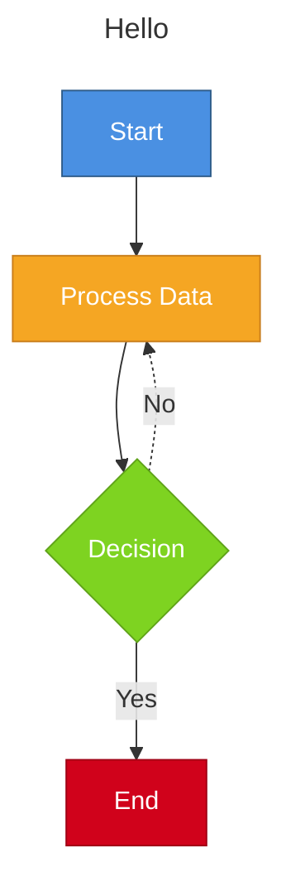
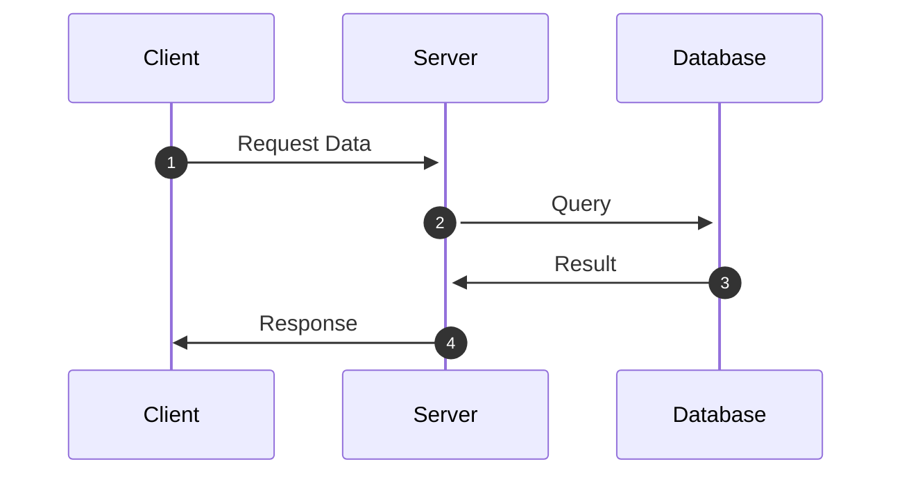
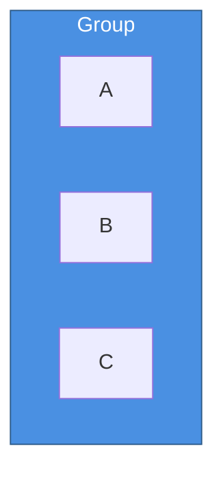
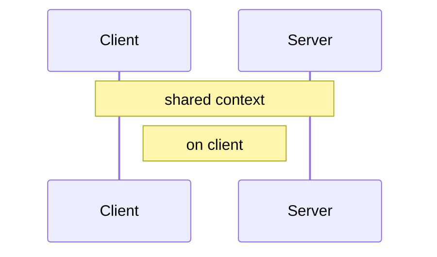

```mermaid
gantt
    dateFormat HH:mm
    Design : 09:00, 12:00
    Build : 12:00, 15:30
    Test : 15:30, 17:00
```

# Periscope

C++20 header-only library that builds Mermaid diagrams (flowchart, sequence, gantt) from typed graph objects.

## Build

```bash
cmake -S . -B build && cmake --build build
./build/bin/PERISCOPE_SANDBOX
```

In another project (`add_subdirectory` / `FetchContent` / `find_package(Periscope)`):

```cmake
target_link_libraries(your_target PRIVATE Periscope::periscope)
```

`#include "periscope.h"` — linking `Periscope::periscope` pulls in `include/` and C++20.

## API at a glance

| Spell | Meaning |
| --- | --- |
| `Object(graph) >> props…` | create `node` / `note` / `class_def` (assign or discard; bare `Object(g)` aborts) |
| `a >> b >> c` | default edges between consecutive nodes |
| `a >> "Yes"_op_name >> LP_style::k_dashed >> b` | decorations sit between nodes |
| `graph >> GP_…` | configure (`>>` ≡ `set` on `graph&`) |
| `new_object<T>(…)` / `new_object_at` / `.set<Prop>(…)` | escape hatches; **`link` stays `new_object<link>`** |
| `label{ runtime_string }` | runtime edge/node name (no bare `std::string` on `>>`) |
| `property_literal<NP_subgraph_node>{ a, b }` | vector-of-handle props |

Mermaid under each example is the verbatim `to_string()` body from running that snippet (same shapes as `sandbox/src/main.cpp`).

## Example 1 — Flowchart

```cpp
#include "periscope.h"
#include <iostream>

using namespace periscope;

int main() {
    graph _graph;
    _graph >> "Hello"_op_name;

    class_def(_graph) >> "Start"_op_name >> "#4A90E2"_mcd_fill >> "#2E5C8A"_mcd_stroke >> "#fff"_mcd_color;
    class_def(_graph) >> "Process"_op_name >> "#F5A623"_mcd_fill >> "#C97E1C"_mcd_stroke >> "#fff"_mcd_color;
    class_def(_graph) >> "Decision"_op_name >> "#7ED321"_mcd_fill >> "#5FA319"_mcd_stroke >> "#fff"_mcd_color;
    class_def(_graph) >> "End"_op_name >> "#D0021B"_mcd_fill >> "#A00115"_mcd_stroke >> "#fff"_mcd_color;

    node& start = node(_graph) >> "Start"_op_name >> NP_shape::k_rectangle >> "Start"_np_class_def;
    node& process = node(_graph) >> "Process Data"_op_name >> NP_shape::k_rectangle >> "Process"_np_class_def;
    node& decision = node(_graph) >> "Decision"_op_name >> NP_shape::k_diamond >> "Decision"_np_class_def;
    node& end = node(_graph) >> "End"_op_name >> NP_shape::k_rectangle >> "End"_np_class_def;

    start >> process >> decision >> "Yes"_op_name >> end;
    decision >> "No"_op_name >> LP_style::k_dashed >> LP_style::k_arrow_mask >> process;

    _graph >> GP_type<>::k_flowchart
           >> GP_output_format<>::k_markdown
           >> GP_flowchart_direction<>::k_top_to_down;

    std::cout << _graph.to_string() << std::endl;
}
```



## Example 2 — Sequence (pointer handles)

Runtime names use `.set<OP_name>(…)` after `new_object_at`, or `label{ msg }` on `>>`.

```cpp
#include "periscope.h"
#include <iostream>
#include <map>

using namespace periscope;

class Service {
public:
    std::string name;
    Service(const std::string& n) : name(n) {}

    static graph<const void*>& get_hook_graph() {
        static graph<const void*> hook_graph;
        return hook_graph;
    }

    void send_request(Service* target, const std::string& msg, bool activate_target = false) {
        auto& hook_graph = get_hook_graph();
        static std::map<const void*, bool> registered;

        handle<const void*> this_handle(reinterpret_cast<const void*>(this));
        handle<const void*> target_handle(reinterpret_cast<const void*>(target));

        if (!registered[this]) {
            hook_graph.new_object_at<node>(this_handle).set<OP_name>(name);
            registered[this] = true;
        }
        if (!registered[target]) {
            hook_graph.new_object_at<node>(target_handle).set<OP_name>(target->name);
            registered[target] = true;
        }

        auto& src = hook_graph.access<node>(this_handle);
        auto& dst = hook_graph.access<node>(target_handle);
        if (activate_target)
            src >> LP_activate::k_activate >> label{ msg } >> dst;
        else
            src >> label{ msg } >> dst;
    }

    static void print_graph() {
        auto& hook_graph = get_hook_graph();
        hook_graph >> GP_type<>::k_sequence
                   >> GP_output_format<>::k_markdown
                   >> GP_sequence_show_number<>::k_on;
        std::cout << hook_graph.to_string() << std::endl;
    }
};

int main() {
    Service client("Client");
    Service server("Server");
    Service database("Database");

    client.send_request(&server, "Request Data", true);
    server.send_request(&database, "Query", true);
    database.send_request(&server, "Result");
    server.send_request(&client, "Response");

    Service::print_graph();
}
```

Participant ids are the live pointer handles from the run:



## Example 3 — Gantt

```cpp
#include "periscope.h"
#include <iostream>

using namespace periscope;

int main() {
    graph _graph;
    _graph >> GP_type<>::k_gantt
           >> GP_output_format<>::k_markdown
           >> GP_date_format<>::k_hour_minute;

    _graph.new_object<node>("Design"_op_name, "9:0"_np_time_tick_start, "12:0"_np_time_tick_end);
    _graph.new_object<node>("Build"_op_name, "12:0"_np_time_tick_start, "15:30"_np_time_tick_end);
    _graph.new_object<node>("Test"_op_name, "15:30"_np_time_tick_start, "17:0"_np_time_tick_end);

    std::cout << _graph.to_string() << std::endl;
}
```



## Example 4 — classDef, subgraph, notes

Vector-of-handle props: `property_literal<Prop>{ node_a, node_b }` (no `.get_handle()`).

```cpp
#include "periscope.h"
#include <iostream>

using namespace periscope;

int main() {
    graph flow;
    flow >> GP_type<>::k_flowchart
         >> GP_output_format<>::k_markdown
         >> GP_flowchart_direction<>::k_top_to_down;

    class_def(flow) >> "GroupStyle"_op_name >> "#4A90E2"_mcd_fill >> "#2E5C8A"_mcd_stroke >> "#fff"_mcd_color;

    node& a = flow.new_object<node>("A"_op_name, NP_shape::k_rectangle);
    node& b = flow.new_object<node>("B"_op_name, NP_shape::k_rectangle);
    node& c = flow.new_object<node>("C"_op_name, NP_shape::k_rectangle);
    flow.new_object<node>(
        "Group"_op_name, property_literal<NP_subgraph_node>{ a, b, c }, "GroupStyle"_np_class_def);

    std::cout << flow.to_string() << std::endl;

    graph seq;
    seq >> GP_type<>::k_sequence >> GP_output_format<>::k_markdown;
    node& client = seq.new_object<node>("Client"_op_name);
    node& server = seq.new_object<node>("Server"_op_name);
    note(seq) >> "shared context"_op_name >> property_literal<MNP_basis>{ client, server };
    note(seq) >> "on client"_op_name >> property_literal<MNP_basis>{ client } >> MNP_orient::k_right;

    std::cout << seq.to_string() << std::endl;
}
```




