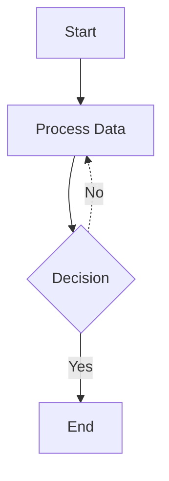
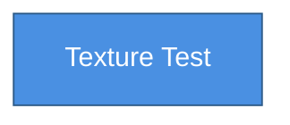
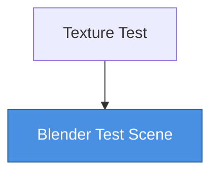
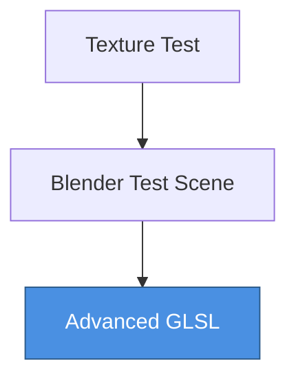
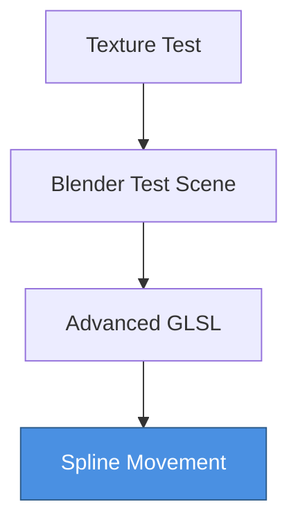

# Periscope

A C++ template library for generating Mermaid diagrams, supporting flowcharts, sequence diagrams, and gantt charts.

## Build and use

Periscope is a header-only CMake `INTERFACE` library. From this repo:

```bash
cmake -S . -B build
cmake --build build
./build/bin/PERISCOPE_SANDBOX   # optional demo (PERISCOPE_BUILD_SANDBOX=ON by default)
```

From another CMake project (`add_subdirectory`, `FetchContent`, or after `cmake --install` + `find_package(Periscope)`):

```cmake
find_package(Periscope REQUIRED)  # or: add_subdirectory / FetchContent
target_link_libraries(your_target PRIVATE Periscope::periscope)
```

Then `#include "periscope.h"`. Linking `Periscope::periscope` propagates the `include/` path and requires C++20.


## Example 1: Flowchart (using int as handle)

Create a flowchart directly using the API with `int` as the handle type:

```cpp
#include "periscope.h"
#include <iostream>

int main() {
    using namespace periscope;

    graph _graph;

    // Variadic new_object applies deduced properties (UDLs / nested enums) in one call
    node& start = _graph.new_object<node>("Start"_op_name, NP_shape::k_rectangle);
    node& process = _graph.new_object<node>("Process Data"_op_name, NP_shape::k_rectangle);
    node& decision = _graph.new_object<node>("Decision"_op_name, NP_shape::k_diamond);
    node& end = _graph.new_object<node>("End"_op_name, NP_shape::k_rectangle);

    // operator>> creates links; labels / composed styles sit between nodes.
    // Each decoration grows a typed pending_link<...> pack (heterogeneous, no type erasure).
    // Literals use "..."_op_name (not bare strings); runtime names use label{}.
    // Edges are one-shot: write the full `a >> props >> b` expression (no named/deferred edge).
    // Chains must end on a target node — `a >> props` (no destination) is incomplete
    // (pending_link is [[nodiscard]]; discarding it aborts rather than silently no-op).
    start >> process >> decision >> "Yes"_op_name >> end;
    decision >> "No"_op_name >> LP_style::k_dashed_arrow >> process;

    _graph.set(GP_type<>::k_flowchart)
          .set(GP_output_format<>::k_markdown)
          .set(GP_flowchart_direction<>::k_top_to_down);
    std::cout << _graph.to_string() << std::endl;
    return 0;
}
```

**Output:**



## Example 2: Sequence Diagram (using pointer as handle, simulating runtime hooks)

Hook object interactions during program execution, using object pointers as handles:

```cpp
#include "periscope.h"
#include <iostream>
#include <map>

class Service {
public:
    std::string name;
    Service(const std::string& n) : name(n) {}
    
    static graph<const void*>& get_hook_graph() {
        static graph<const void*> hook_graph;
        return hook_graph;
    }
    
    void send_request(Service* target, const std::string& msg) {
        auto& hook_graph = get_hook_graph();
        static std::map<const void*, bool> registered;
        
        handle<const void*> this_handle(reinterpret_cast<const void*>(this));
        handle<const void*> target_handle(reinterpret_cast<const void*>(target));
        
        // new_object_at takes the same deduced property pack as new_object;
        // runtime strings keep explicit set<OP_name> (no property_literal factory).
        if (!registered[this]) {
            hook_graph.new_object_at<node>(this_handle).set<OP_name>(name);
            registered[this] = true;
        }
        if (!registered[target]) {
            hook_graph.new_object_at<node>(target_handle).set<OP_name>(target->name);
            registered[target] = true;
        }

        // Runtime message via explicit label{}; literals prefer "..."_op_name
        hook_graph.access<node>(this_handle) >> label{ msg } >> hook_graph.access<node>(target_handle);
    }
    
    static void print_graph() {
        auto& hook_graph = get_hook_graph();
        hook_graph.set(GP_type<>::k_sequence)
                  .set(GP_output_format<>::k_markdown)
                  .set(GP_sequence_show_number<>::k_on);
        std::cout << hook_graph.to_string() << std::endl;
    }
};

int main() {
    Service client("Client");
    Service server("Server");
    Service database("Database");
    
    // Business logic triggers hooks
    client.send_request(&server, "Request Data");
    server.send_request(&database, "Query");
    database.send_request(&server, "Result");
    server.send_request(&client, "Response");
    
    // Output sequence diagram
    Service::print_graph();
    return 0;
}
```

**Output:**


## Example 3: Gantt Chart (using int as handle)

Create a gantt chart with time-tick start/end on each task node. Ticks are
formatted to match `GP_date_format` (zero-padded `HH:mm` or `MM-DD`):

```cpp
#include "periscope.h"
#include <iostream>

int main() {
    using namespace periscope;

    graph _graph;
    _graph.set(GP_type<>::k_gantt)
          .set(GP_output_format<>::k_markdown)
          .set(GP_date_format<>::k_hour_minute);

    // Pack name + ticks via deduced UDLs (mirrors OP_/NP_ naming)
    _graph.new_object<node>("Design"_op_name, "9:0"_np_time_tick_start, "12:0"_np_time_tick_end);
    _graph.new_object<node>("Build"_op_name, "12:0"_np_time_tick_start, "15:30"_np_time_tick_end);
    _graph.new_object<node>("Test"_op_name, "15:30"_np_time_tick_start, "17:0"_np_time_tick_end);

    std::cout << _graph.to_string() << std::endl;
    return 0;
}
```

**Output:**



```mermaid
gantt
    dateFormat HH:mm
    Design : 09:00, 12:00
    Build : 12:00, 15:30
    Test : 15:30, 17:00
```

## Example 4: Take snapshots to illustrate active test switching.



--------------- Next graph -----------------


--------------- Next graph -----------------


--------------- Next graph -----------------

